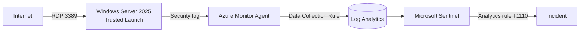

# Azure Sentinel Honeypot

Internet-exposed Windows Server in Azure, monitored with Microsoft Sentinel.
Built to practise detection engineering and SOC workflows (SC-200 topics).

## Architecture



## What's in this repo

| File | Purpose |
|---|---|
| `deploy.sh` | Builds the whole lab end to end with Azure CLI |
| `teardown.sh` | Deletes the lab (asks for confirmation) |
| `dcr/security-events.json` | Data Collection Rule: Windows Security log to Log Analytics |
| `rules/rdp-bruteforce.json` | Custom Sentinel analytics rule |
| `env.sh` | Session variables for Azure Cloud Shell |

## Detection rule

- **Logic:** 10 or more failed logons (EventID 4625) from one source IP within 1 hour
- **Schedule:** runs every hour over the previous hour
- **MITRE ATT&CK:** T1110 Brute Force (Credential Access)
- **Entity mapping:** source IP, so the incident shows the attacker address

```kql
SecurityEvent
| where EventID == 4625 and IpAddress != "-"
| summarize Attempts = count(), Accounts = make_set(TargetAccount, 10),
            FirstSeen = min(TimeGenerated), LastSeen = max(TimeGenerated) by IpAddress
| where Attempts >= 10
```

## Validation

Controlled test on 2026-10-17 instead of waiting for real attackers:

1. 10 failed RDP logons from my own IP within an hour
2. Logs showed 12 × EventID 4625 and 1 × EventID 4740 (account locked out after 10 attempts)
3. Rule fired and created a Medium incident
4. Triaged and closed as **Benign Positive – suspicious but expected**


## Reproducibility

The full lab was rebuilt from scratch in a separate resource group with `deploy.sh`,
verified (resources, Trusted Launch, analytics rule) and torn down with `teardown.sh`.

```bash
git clone https://github.com/Tuomas404/azure-sentinel-honeypot.git
cd azure-sentinel-honeypot
bash deploy.sh      # prompts for VM admin password
bash teardown.sh    # deletes everything
```

## Lessons learned

- **Wrong default subscription:** Azure CLI defaulted to a different production subscription linked to my student account. Every command now pins `--subscription`.
- **Missing resource providers:** registration errors appeared step by step; all providers are now registered at the start of `deploy.sh`.
- **Capacity and deprecation:** `Standard_B2s` was unavailable in Sweden Central and the `Win2022Datacenter` image alias is scheduled for deprecation, so the lab uses `Standard_B2als_v2` and Windows Server 2025 Gen2.
- **Events are not attempts:** 10 human attempts produced 12 failed-logon events. Thresholds must account for this.
- **Window evasion:** an hourly rule misses low-and-slow attacks (e.g. 6 attempts per hour). Planned fix: a second rule with a 24 h window.
- **Account lockout trade-off:** lockout stops password guessing but lets anyone who knows the username lock it (denial of service).

## Cost control

Budget alert, nightly auto-shutdown, Sentinel 31-day free trial, and `teardown.sh` to delete everything.

## Next steps

- 24 h low-and-slow detection rule
- Automation rule to auto-close known test IPs
- Bicep version of `deploy.sh`
