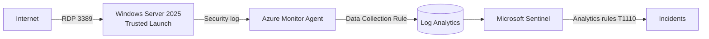
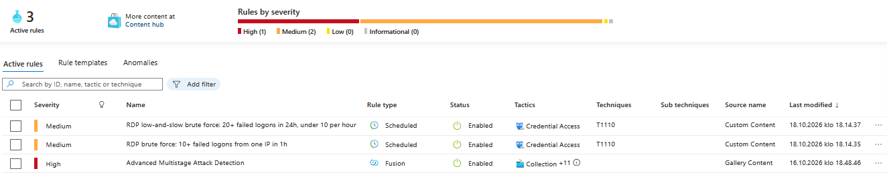
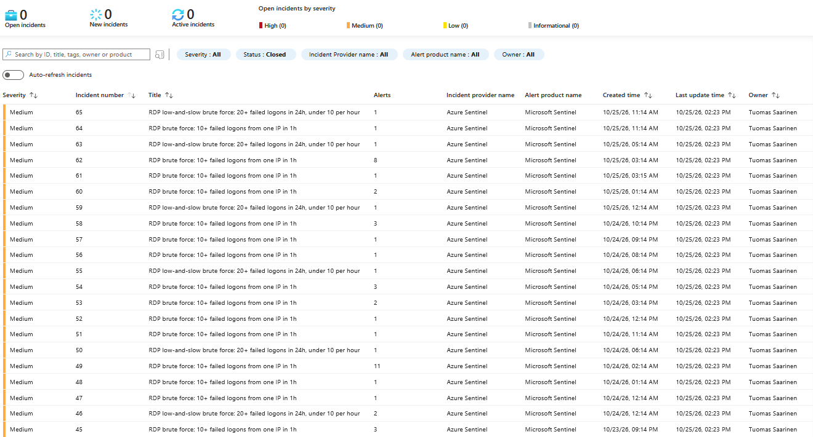
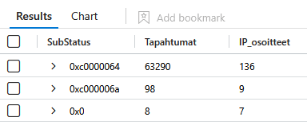
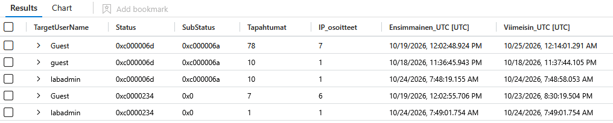
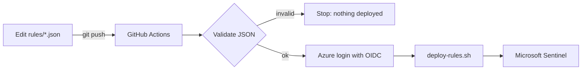

# Azure Sentinel Honeypot

Internet-exposed Windows Server in Azure, monitored with Microsoft Sentinel.
Built to practise detection engineering and SOC workflows (SC-200 topics):
two custom detection rules, both validated with controlled tests, and one week of
real internet attacks (63,396 failed-logon events from 136 IPs) detected, investigated
and closed with no successful logons. Rules are managed as code and deployed to
Sentinel by GitHub Actions, with no stored credentials.

**Status:** lab torn down on 2026-10-25 after one week of data collection.
It can be rebuilt in about 15 minutes with `deploy.sh`.

## Architecture



## What's in this repo

| File | Purpose |
|---|---|
| `deploy.sh` | Builds the whole lab end to end with Azure CLI |
| `deploy-rules.sh` | Deploys every rule in `rules/` to Sentinel |
| `.github/workflows/deploy-rules.yml` | Validates and deploys rules on every push to `rules/` |
| `setup-ci.sh` | Creates the Azure identity GitHub Actions logs in with (OIDC) |
| `teardown.sh` | Deletes the lab (asks for confirmation) |
| `dcr/security-events.json` | Data Collection Rule: Windows Security log to Log Analytics |
| `rules/rdp-bruteforce.json` | Rule 1: fast brute force |
| `rules/rdp-lowandslow.json` | Rule 2: low-and-slow brute force |
| `queries/attack-stats.kql` | Statistics queries with a fixed time window, so the numbers can be reproduced |
| `results/` | Query results as CSV (attacker IP addresses removed) |
| `images/` | Screenshots from Sentinel |
| `env.sh` | Session variables for Azure Cloud Shell |

## Detection rules

Both rules map the source IP as an entity and group alerts from the same IP into one incident.

| | Rule 1: Fast brute force | Rule 2: Low-and-slow |
|---|---|---|
| Logic | ≥ 10 failed logons (4625) from one IP in 1 h | ≥ 20 in 24 h, spread over ≥ 3 hours, < 10 in any hour |
| Runs | Every hour, over the last hour | Every 6 hours, over the last 24 hours |
| MITRE ATT&CK | T1110 Brute Force | T1110 Brute Force |

Rule 2 is designed to catch attackers who stay under Rule 1's hourly threshold,
and it excludes fast attacks so the same activity does not create two incidents.

```kql
// Rule 2
SecurityEvent
| where EventID == 4625 and IpAddress != "-"
| summarize HourlyAttempts = count() by IpAddress, Hour = bin(TimeGenerated, 1h)
| summarize Attempts = sum(HourlyAttempts), ActiveHours = dcount(Hour),
            MaxPerHour = max(HourlyAttempts) by IpAddress
| where Attempts >= 20 and ActiveHours >= 3 and MaxPerHour < 10
```



## Validation

**Test 1, fast brute force (2026-10-17):** 10 failed RDP logon attempts from my own IP within an hour.
Logs showed 12 × EventID 4625 and 1 × EventID 4740 (account locked out after 10 attempts).
Rule 1 created an incident, closed as *Benign Positive – suspicious but expected*.


**Test 2, low-and-slow (2026-10-18):** 3 × 7 failed logons in separate hours (max 7 per hour).
Rule 2 created an incident and Rule 1 correctly stayed silent. Closed as *Benign Positive*.


## First real attack (2026-10-17)

| | |
|---|---|
| Activity | 81 failed-logon events (EventID 4625) from one IP, 15:59–19:58 UTC, up to 21 per hour |
| IP geolocation | India (geolocation shows where the IP is, not who the attacker is) |
| Accounts tried | `Administrator`, `Admin`: neither exists on the host |
| Successful remote logons | None (no EventID 4624 logon type 3 or 10 from remote IPs in 3 days) |
| Outcome | No compromise. Activity ended when the VM's nightly auto-shutdown ran |
| Classification | *True Positive – suspicious activity* |

Rule 1 created one incident per hourly run (4 incidents for one attacker).
Fix: enabled alert grouping by entity, so repeated alerts from one IP join a single incident.


## One week of internet exposure (2026-10-17 – 2026-10-25)

After the first attack I turned off auto-shutdown and kept the VM running 24/7 from
2026-10-18 to 2026-10-25. All numbers come from `queries/attack-stats.kql` with a fixed
time window, and my own test IP is excluded. Raw results are in `results/`.

| | |
|---|---|
| Failed-logon events (4625) | 63,396 |
| Source IPs | 136, from 25 countries or regions (IP geolocation) |
| Usernames tried | 954 different names |
| Successful remote logons | None (no EventID 4624 logon type 3 or 10 from remote IPs) |
| Incidents | 65: 63 real attacks (Rule 1: 49, Rule 2: 14) and 2 from my own tests. All investigated and closed |



*Times in the screenshot are Finnish time (UTC+3 until 25 Oct, then UTC+2).*

### Who attacked and how

| Username | Events | IPs |
|---|---|---|
| Administrator | 33,181 | 116 |
| Admin | 7,803 | 14 |
| admin | 1,748 | 11 |
| administrator | 1,538 | 7 |
| user | 836 | 7 |

| Country (IP geolocation) | Events | IPs |
|---|---|---|
| Poland | 21,305 | 2 |
| Germany | 18,116 | 7 |
| South Korea | 6,205 | 31 |
| United States | 5,103 | 29 |
| Sweden | 4,861 | 3 |

- **Default admin name first:** `Administrator` got 52% of all events, tried by 116 of the 136 IPs.
- **A few heavy attackers dominate the volume:** two IPs in Poland produced 34% of all events, trying only `Administrator`.
- **Distributed scanning:** South Korea and the US had around 30 IPs each with only a few hundred events per IP or less.
- **Generic wordlists, not targeted attacks:** one IP tried names such as `user`, `nurse`, `confroom`, `scanner` and `clinic`.

### Why every attempt failed

| Reason (Windows SubStatus / Status) | Events | IPs |
|---|---|---|
| Account does not exist (`0xc0000064`) | 63,290 (99.8%) | 136 |
| Real account, wrong password (`0xc000006a`) | 98 | 9 |
| Account locked out (Status `0xc0000234`) | 8 | 7 |



The 98 wrong-password events hit two existing accounts: the built-in `Guest` (disabled by default)
and my admin account `labadmin`. On 2026-10-24 one IP tried `labadmin` with 10 wrong passwords in
39 seconds (07:48:19–07:48:58 UTC). The 11th attempt hit the account lockout at 07:49:01 UTC,
and nobody tried `labadmin` again.



### When

Distinct attacking IPs per hour of day (UTC, 19–25 Oct) stayed between 53 and 72 in every hour:
bots work around the clock. Event counts peaked at 07–08 UTC (over 11,000 per hour) because of a few
large bursts, which is why I compare IP counts, not event counts.

## CI/CD: detection as code



- **Trigger:** push to `main` that changes `rules/`, `deploy-rules.sh` or the workflow. Can also be run by hand.
- **Validation:** every rule file must have `ruleId`, `kind`, `displayName` and `query`, or the job stops before touching Azure.
- **No stored passwords:** GitHub gets a short-lived token, and Azure trusts it only for this repo's `main` branch (federated credential on a managed identity).
- **Least privilege:** the identity has *Microsoft Sentinel Contributor* on the lab resource group only. It can edit rules but cannot change the VM, networking or permissions.
- **Tested end to end (2026-10-18):** changed Rule 1's description in Git, and the new text and modification time appeared in Sentinel without any manual step.
- **Disabled after teardown:** the workflow is disabled because its Azure identity was deleted with the lab.

## Reproducibility

The full lab was rebuilt from scratch in a separate resource group with `deploy.sh`,
verified (resources, Trusted Launch, analytics rule) and torn down with `teardown.sh`.

```bash
git clone https://github.com/Tuomas404/azure-sentinel-honeypot.git
cd azure-sentinel-honeypot
bash deploy.sh        # prompts for VM admin username and password
bash setup-ci.sh      # identity for GitHub Actions, prints values for repo secrets
bash deploy-rules.sh  # manual rule deploy (CI does this on push)
bash teardown.sh      # deletes everything, including the CI identity
```

## Lessons learned

- **A non-default admin name helps, but is not enough on its own:** it filtered out 99.8% of attempts, but `labadmin` was in one attacker's wordlist. Account lockout stopped the guessing after 10 tries, and a strong password would have held anyway. Security comes in layers.
- **Alert fatigue:** one exposed VM produced 63 real incidents in a week, even with alert grouping. In production I would add an automation rule for repeated attacks, and above all not expose RDP to the internet (Azure Bastion, VPN or just-in-time access instead).
- **A few attackers skew event counts:** two IPs produced a third of all events. Distinct IPs describe attackers better than event totals.
- **Publish statistics with a fixed time window:** the same query with `ago()` gave 140 and 144 a few minutes apart. Fixed dates make the numbers reproducible.
- **Data minimisation:** attacker IP addresses were removed from the published results. IP addresses can be personal data under GDPR, and attacking IPs often belong to compromised home devices.
- **Duplicate incidents:** an hourly rule without grouping turned one attacker into four incidents. Grouping by entity fixed it.
- **Geolocation is not attribution:** attack traffic often comes from rented servers, VPNs or compromised hosts.
- **Tests interfere with each other:** a 24 h rule still "sees" yesterday's fast test, so tests must be scheduled outside each other's windows.
- **Events are not attempts:** 10 human attempts produced 12 failed-logon events. Thresholds must account for this.
- **Account lockout trade-off:** lockout stops password guessing but lets anyone who knows the username lock it (denial of service).
- **Wrong default subscription:** Azure CLI defaulted to a different production subscription linked to my student account. Every command now pins `--subscription`.
- **Missing resource providers:** registration errors appeared step by step; all providers are now registered at the start of `deploy.sh`.
- **OIDC subject format:** the first Actions login failed because GitHub's token subject now contains the owner and repo IDs (`repo:Owner@id/repo@id:...`), not just the names. IDs cannot be reused if a repo is deleted and recreated, which blocks a name-takeover attack. The error message showed the exact subject to trust.
- **Least privilege has gaps to plan for:** *Microsoft Sentinel Contributor* can edit rules but cannot read the Log Analytics workspace resource itself, so the workflow passes the workspace ID instead of looking it up.
- **Line endings:** shell scripts edited on Windows can get CRLF line endings that break Bash on Linux runners. `.gitattributes` forces LF for `*.sh`.
- **Capacity and deprecation:** `Standard_B2s` was unavailable in Sweden Central and the `Win2022Datacenter` image alias is scheduled for deprecation, so the lab uses `Standard_B2als_v2` and Windows Server 2025 Gen2.

## Cost control

Budget alert (€10/month), Sentinel 31-day free trial, and `teardown.sh` to delete everything.
Nightly auto-shutdown was on until 2026-10-18 and then turned off for the data-collection week.
Total cost was about €13.50 from Azure for Students credit, so spending passed the budget
alert threshold as expected for 24/7 operation.

## Next steps

- Automation rule for repeated attacks and a watchlist for my own test IPs
- Run each rule's KQL query in CI before deploying, not just validate the JSON structure
- Bicep version of `deploy.sh`
- Entra ID sign-in logs into Sentinel together with my [hybrid identity lab](https://github.com/Tuomas404/hybrid-identity-lab)
