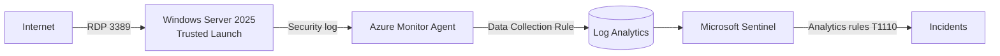

# Azure Sentinel Honeypot

Internet-exposed Windows Server in Azure, monitored with Microsoft Sentinel.
Built to practise detection engineering and SOC workflows (SC-200 topics):
two custom detection rules, both validated with controlled tests, and one real
internet brute-force attack detected, investigated and closed.

## Architecture



## What's in this repo

| File | Purpose |
|---|---|
| `deploy.sh` | Builds the whole lab end to end with Azure CLI |
| `deploy-rules.sh` | Deploys every rule in `rules/` to Sentinel |
| `teardown.sh` | Deletes the lab (asks for confirmation) |
| `dcr/security-events.json` | Data Collection Rule: Windows Security log to Log Analytics |
| `rules/rdp-bruteforce.json` | Rule 1: fast brute force |
| `rules/rdp-lowandslow.json` | Rule 2: low-and-slow brute force |
| `env.sh` | Session variables for Azure Cloud Shell |

## Detection rules

Both rules map the source IP as an entity and group alerts from the same IP into one incident.

| | Rule 1: Fast brute force | Rule 2: Low-and-slow |
|---|---|---|
| Logic | ≥ 10 failed logons (4625) from one IP in 1 h | ≥ 20 in 24 h, spread over ≥ 3 hours, < 10 in any hour |
| Runs | Every hour, over the last hour | Every 6 hours, over the last 24 hours |
| MITRE ATT&CK | T1110 Brute Force | T1110 Brute Force |

Rule 2 is designed to catch attackers who stay under Rule 1's hourly threshold,
and it excludes fast attacks so the same activity does not create two incidents.

```kql
// Rule 2
SecurityEvent
| where EventID == 4625 and IpAddress != "-"
| summarize HourlyAttempts = count() by IpAddress, Hour = bin(TimeGenerated, 1h)
| summarize Attempts = sum(HourlyAttempts), ActiveHours = dcount(Hour),
            MaxPerHour = max(HourlyAttempts) by IpAddress
| where Attempts >= 20 and ActiveHours >= 3 and MaxPerHour < 10
```

## Validation

**Test 1, fast brute force (2026-10-17):** 10 failed RDP logons from my own IP within an hour.
Logs showed 12 × EventID 4625 and 1 × EventID 4740 (account locked out after 10 attempts).
Rule 1 created an incident, closed as *Benign Positive – suspicious but expected*.


**Test 2, low-and-slow (2026-10-18):** 3 × 7 failed logons in separate hours (max 7 per hour).
Rule 2 created an incident and Rule 1 correctly stayed silent. Closed as *Benign Positive*.


## First real attack (2026-10-17)

| | |
|---|---|
| Activity | 81 failed RDP logons from one IP, 15:59–19:58 UTC, up to 21 per hour |
| IP geolocation | India (geolocation shows where the IP is, not who the attacker is) |
| Accounts tried | `Administrator`, `Admin`: neither exists on the host |
| Successful remote logons | None (no EventID 4624 logon type 3 or 10 from remote IPs in 3 days) |
| Outcome | No compromise. Activity ended when the VM's nightly auto-shutdown ran |
| Classification | *True Positive – suspicious activity* |

Rule 1 created one incident per hourly run (4 incidents for one attacker).
Fix: enabled alert grouping by entity, so repeated alerts from one IP join a single incident.


A few other IPs made 1–2 attempts each (scanners), below both thresholds by design.

## Reproducibility

The full lab was rebuilt from scratch in a separate resource group with `deploy.sh`,
verified (resources, Trusted Launch, analytics rule) and torn down with `teardown.sh`.

```bash
git clone https://github.com/Tuomas404/azure-sentinel-honeypot.git
cd azure-sentinel-honeypot
bash deploy.sh        # prompts for VM admin password
bash deploy-rules.sh  # re-deploy rules only, after editing rules/
bash teardown.sh      # deletes everything
```

## Lessons learned

- **Non-default admin name works:** the real attacker only tried `Administrator` and `Admin`, so password guessing never reached the real account.
- **Duplicate incidents:** an hourly rule without grouping turned one attacker into four incidents. Grouping by entity fixed it.
- **Geolocation is not attribution:** attack traffic often comes from rented servers, VPNs or compromised hosts.
- **Tests interfere with each other:** a 24 h rule still "sees" yesterday's fast test, so tests must be scheduled outside each other's windows.
- **Events are not attempts:** 10 human attempts produced 12 failed-logon events. Thresholds must account for this.
- **Account lockout trade-off:** lockout stops password guessing but lets anyone who knows the username lock it (denial of service).
- **Wrong default subscription:** Azure CLI defaulted to a different production subscription linked to my student account. Every command now pins `--subscription`.
- **Missing resource providers:** registration errors appeared step by step; all providers are now registered at the start of `deploy.sh`.
- **Capacity and deprecation:** `Standard_B2s` was unavailable in Sweden Central and the `Win2022Datacenter` image alias is scheduled for deprecation, so the lab uses `Standard_B2als_v2` and Windows Server 2025 Gen2.

## Cost control

Budget alert, nightly auto-shutdown, Sentinel 31-day free trial, and `teardown.sh` to delete everything.

## Next steps

- Automation rule to auto-close incidents from known test IPs
- GitHub Actions to run `deploy-rules.sh` on every commit to `rules/`
- Bicep version of `deploy.sh`
